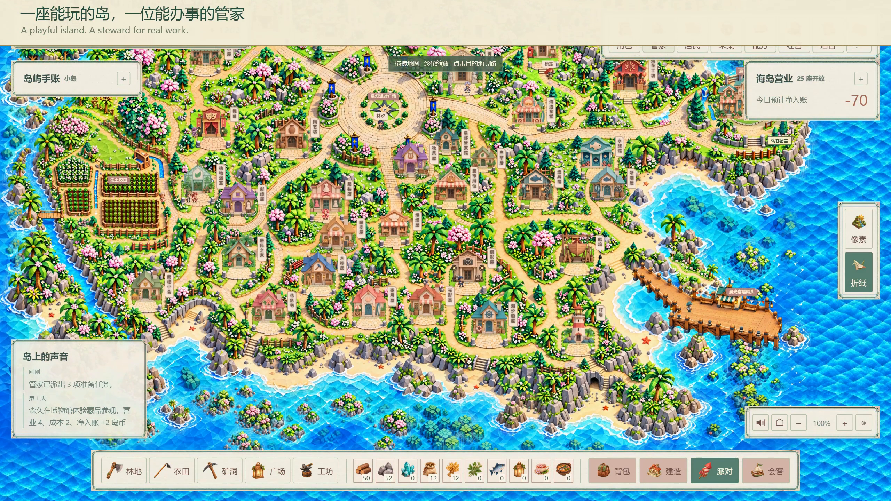

# Hyper Dimension

[中文](README.md) · [English](README.en.md)

**一座能玩的岛，一位能办事的管家。**

采集、种植、制作、经营与派对，和 AI 居民一起生活；让自己的 Hermes Agent 管家整理资料、制定计划、处理真实文档。像素与折纸两种画风，共用同一小岛和存档。

[](https://mkaliezz.github.io/hyper-dimension/#living)

**[播放 30 秒演示](https://mkaliezz.github.io/hyper-dimension/#living)** · 1440p / 60 fps · 原创配乐

演示人物与资料均为虚构示例；AI 回应、Hermes 文件操作和管家 A2A 来信来自真实执行。**小游戏目前为占位演示，后续将继续优化。**

## 在岛上做什么

| 体验 | 内容 |
| --- | --- |
| 经营与创造 | 25 类功能建筑、19 种作物、58 种素材、308 个配方。制作备货、设置货架、接待游客、使用工具、派对与奇观；账目区分日常经营和建设投入。 |
| 居民与家园 | 15 位 AI 居民，自由交流、职业作息与关系记录；十六户按主人职业和爱好设计的住所。 |
| 你的 Agent 管家 | 自定义姓名与 12 套形象；Hermes 处理现实工作，招募临时伙伴，为居民安排有前置依赖的工作。 |
| 季节与来访 | 每季 30 个视觉日，天气影响种植与钓鱼；昼夜灯火、海浪与月影。跨岛携带管家与受邀 NPC，通过 A2A 交换信息、协商筹备并补充说明；来访岛主确认后才预留物资。 |
| 展示与共创 | 会客馆陈列经历、项目、图片并接收留言。OPC 导入双画风物品和配方，经审核发布、制作、上架，也可导出与回退。 |

## 启动小岛

准备 **Node.js 24、Python 3.11**。支持 Windows x64、macOS 14+（Apple Silicon / Intel）及 Ubuntu。克隆后进入 `island/`；独立源码包直接在根目录执行：

```sh
node tools/agent-deploy.mjs plan
node tools/agent-deploy.mjs doctor --python=python
node tools/agent-deploy.mjs setup --python=python --offline
node tools/agent-deploy.mjs verify
node tools/agent-deploy.mjs run --mode=lan
```

macOS / Ubuntu 使用 `--python=python3`；Ubuntu 去掉 `--offline`。启动后访问 `http://127.0.0.1:4175/play`。

若下载到分卷，先按[分卷说明](island/docs/source-parts.md)校验合并，再部署。

密钥放在私有 `.env.local`，无密钥可运行规则模式。更新时保留并备份 `data/` 和私有配置。也可把源码交给任意有终端权限的 Agent，按 [AGENTS.md](island/AGENTS.md) 与[部署指南](island/DEPLOYMENT.md) 操作。

[下载源码](https://github.com/MkaliezZ/hyper-dimension/releases) · [OPC 共创课](island/public/assets/cocreation/course-v2.md) · [Agent / A2A](island/docs/a2a-standard-v158.md) · [教培模块](README.education.md)

[MIT 许可](LICENSE) · [第三方声明](island/THIRD_PARTY_NOTICES.md)
