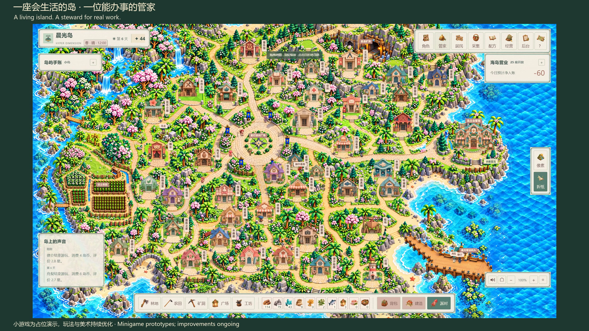
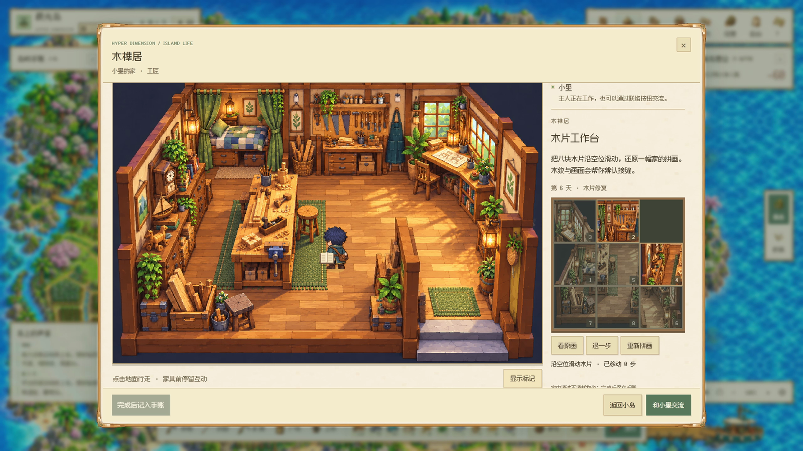
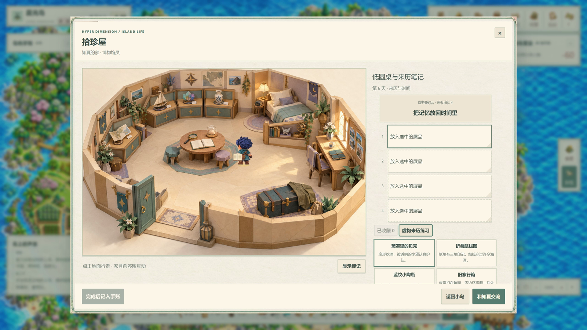

# Hyper Dimension

[中文](README.md) · [English](README.en.md)

**A living island. A steward for real work.**

Gather, craft, run your island, host parties and talk freely with AI residents. Delegate research, planning and real document creation to your Hermes Agent steward. Pixel and origami styles share one island and save.

## See the island

[](https://mkaliezz.github.io/hyper-dimension/#living)

[Watch the 30-second demo](https://mkaliezz.github.io/hyper-dimension/#living) · [Explore the owner gallery](https://mkaliezz.github.io/hyper-dimension/#gallery)

Original soundtrack. Profiles and briefs are fictional; steward documents were produced with real tools. **Minigames are placeholder demonstrations and will keep improving.**

## Core experiences

| Experience | What you can do |
| --- | --- |
| Run an island | 25 functional building types, 19 crops, 58 materials and 308 recipes. Gather, grow and craft. Components feed later recipes; tools are reusable. Supply residents, visitors and events, with a modest passive surplus on mature islands. |
| Meet AI residents | 15 residents with distinct jobs, personalities and relationships, free conversation and daily routines. Leisure and social pauses persist across reloads. |
| Visit a home | Explore sixteen distinct homes shaped by their owners’ work and interests, try personal hobbies and keep a household journal. |
| Delegate to your steward | Choose a name and one of 12 appearances. Use Hermes for real work, recruit a temporary Agent partner, and queue up to four ordered jobs for a resident to follow during their work hours. |
| Seasons and two styles | Regional seasonal terrain, waves, weather, evening lights and rippling moon reflections. Each season lasts 30 visual days; weather affects farming and fishing. |
| Showcase and visit | Share experience, projects and images in your gallery, with guest messages. Bring NPC companions and use steward bridging and A2A in multiplayer reception. |
| Create with OPC | Add real products and ingredient chains with pixel/origami artwork. Review, publish, craft, export for reuse and roll back versions. |

| Pixel · Joinery home | Origami · Curator home |
| --- | --- |
|  |  |

## Quick start

Supports **Windows x64 and macOS 14+ (Apple Silicon / Intel)**; Ubuntu can also run it. Install Node.js 24 and Python 3.11. Run these commands from the game directory.

```sh
node tools/agent-deploy.mjs plan
node tools/agent-deploy.mjs doctor --python=python
node tools/agent-deploy.mjs setup --python=python --offline
node tools/agent-deploy.mjs verify
node tools/agent-deploy.mjs run --mode=lan
```

On macOS and Ubuntu, use `--python=python3` instead of `--python=python`. On Ubuntu, omit `--offline` to install online. Open `http://127.0.0.1:4175/play` after launch.

Keep API keys in private `.env.local`. Rules mode works without a key. Back up and preserve `data/` and private configuration when updating. You can also give the source to any Agent with terminal access and ask it to follow [DEPLOYMENT.md](DEPLOYMENT.md) and [AGENTS.md](AGENTS.md).

## More

[Deployment and configuration](DEPLOYMENT.md) · [OPC co-creation course (Chinese)](public/assets/cocreation/course-v2.md) · [Agents / A2A](docs/a2a-standard-v158.md) · [Downloads](https://github.com/MkaliezZ/hyper-dimension/releases) · [Education module](../README.education.md)

Code is [MIT](LICENSE) licensed. See [third-party notices](THIRD_PARTY_NOTICES.md).
