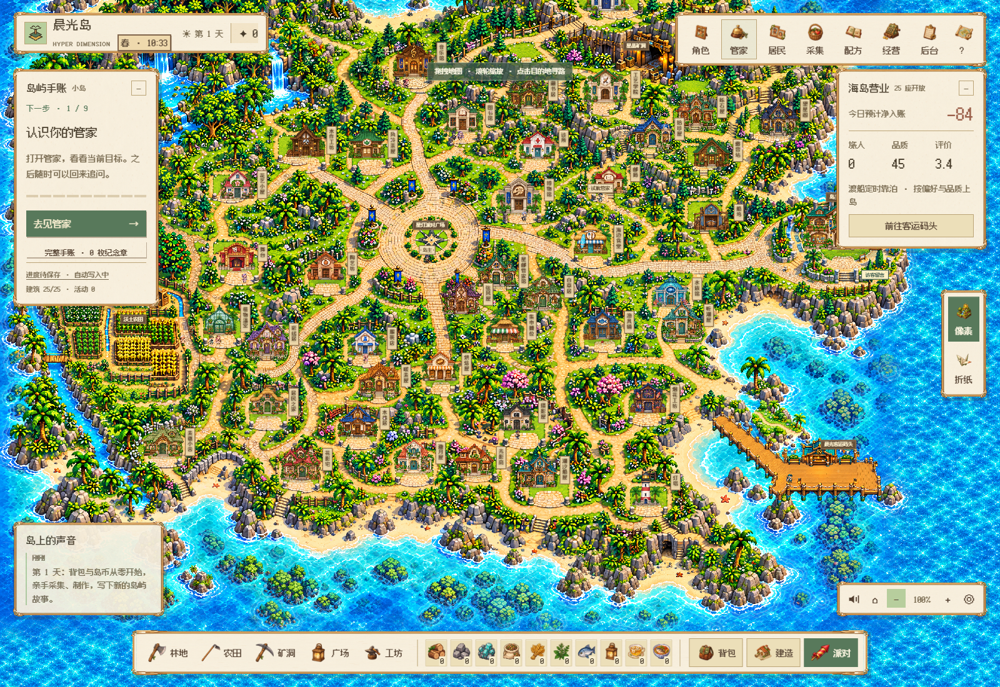
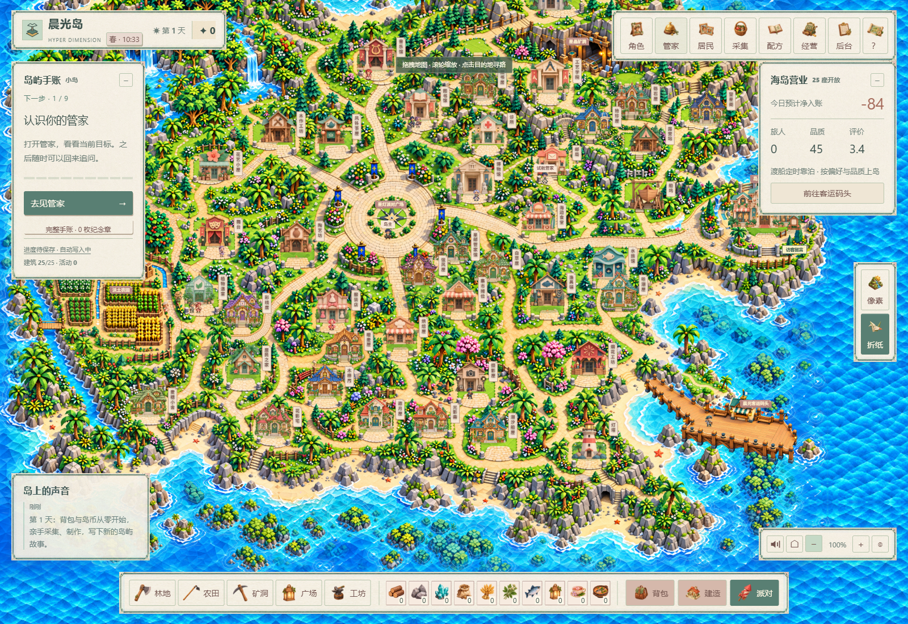

# Hyper Dimension

[中文](README.md) · [English](README.en.md) · [Deployment](DEPLOYMENT.md) · [Education module](https://github.com/MkaliezZ/hyper-dimension/blob/main/README.education.md)

**An island that feels alive, and a steward that gets things done.**

Gather, craft, run your island and host parties. Talk freely with AI residents, or ask a Hermes Agent steward to read your briefs, organize plans and create real work documents. Pixel and origami share one island and save.

## Watch the island

[](https://mkaliezz.github.io/hyper-dimension/?lang=en#living)

[Play the 30-second film](https://mkaliezz.github.io/hyper-dimension/?lang=en#living) · [Inside the owner gallery](https://mkaliezz.github.io/hyper-dimension/?lang=en#gallery) · [Source releases](https://github.com/MkaliezZ/hyper-dimension/releases)

1440p / 60 fps with original BGM. New terrain footage comes from V169; resident, document, parent/child Agent and minigame scenes retain their recorded versions and evidence sources. Profiles and task documents are fictional. **Minigames are demonstration prototypes; gameplay, art and animation will continue improving.**

## What's new · V170

Crafting rewards and closing cancellation now wait for submitted resident transactions instead of losing the request during brief concurrency. An uncertain response retains the original job; explicit recovery lets the original close complete. Six native claim, cancel and lost-response cases passed across both styles, preserving one-time costs and receipts. [Fix and evidence](docs/reward-drain-v170.md).

The expanded terrain and homes retain V169. The current film records terrain and UI from V169, with three Agent/party scenes explicitly labelled V166.

### V169 · Organic terrain and staggered homes

- **A more natural island:** mountain ridges, hills, waterfalls, a river valley, terraced fields, a cave entrance and irregular bays. The continuous terrain loads as 30 independently generated high-resolution regions.
- **Staggered neighbourhoods:** 25 production buildings follow roads and terrain. All 15 AI residents and the steward have distinct homes; the owner gallery shares the mainland and the harbor keeps its own approach lanes.
- **Shared identity and progress:** both styles use the same building, home and save identities. Older worlds are backed up and migrated while retaining currency, inventory, crafting records and character profiles. Restoring or importing an older checkpoint also adapts it to the new map.
- **Continuous movement:** a distance budget spans consecutive waypoints, preserving walking speed and facing across refresh rates. Entrances and wonder display spaces have been recalibrated.

[Terrain implementation and verification scope](docs/geography-v169.md) · [Overall validation](docs/VALIDATION.md)

## Life on the island

| Experience | Content |
| --- | --- |
| Start from zero | 25 production buildings, 50 basic materials and 300 recipes; gathering, crafting, visitor spending and island expenses. An operating day is 900 active game seconds. |
| Meet residents | 15 AI NPCs act according to occupation, personality and relationships, with free conversation and cooperative work. The model is DeepSeek V4.1 Flash. |
| Delegate real work | A named steward with 12 selectable appearances uses Hermes to read delegated files, create documents, track tasks and recruit a temporary Agent partner. |
| Showcase and host | The owner gallery supports life, education and employment histories, projects, pictures, uploads, drafts, publishing, visitor messages and replies. |
| Travel with your steward | Multiplayer reception, accompanying NPCs, original-device bridging and standard A2A share attributed cooperation records. Cross-device work needs pairing and an online original device. |
| Change art styles | Pixel and origami terrain, buildings, characters, rooms, items and UI, with native region loading, animated ocean ripples and shore waves. |

The season interface uses 30 visual days per season. Full-map seasonal artwork, useful weather, night lighting and resident schedules are continuing development on the expanded island. This update provides home exteriors, owner profiles and conversation entries.

## Native screenshots

| Pixel island | Origami island |
| --- | --- |
|  |  |

## Deploy with a development Agent

The deliverable contains **source, artwork, pinned dependencies and a machine-readable deployment protocol**. Windows x64 and macOS 14+ on Apple Silicon / Intel are supported; Ubuntu can also run it. Enter `` after cloning. A Release source archive starts directly at the game root.

Have an Agent with terminal and file access read [AGENTS.md](AGENTS.md), [deploy.json](deploy.json) and [DEPLOYMENT.md](DEPLOYMENT.md), then run:

```sh
node tools/agent-deploy.mjs plan
node tools/agent-deploy.mjs doctor --python=python
node tools/agent-deploy.mjs setup --python=python --offline
node tools/agent-deploy.mjs verify
node tools/agent-deploy.mjs run --mode=lan
```

On macOS, usually select `--python=python3`. Node.js 24 and Python 3.11 are recommended. `--offline` uses bundled pinned dependencies on Windows/macOS CPython 3.11.

- `lan`: reception and island at `http://127.0.0.1:4175/play` by default.
- `pixel` / `origami`: individual launch modes; appearance switching still shares the same save.
- Keep API keys in private `.env.local` or environment variables. Without a key, rules mode works.
- Preserve `data/`, private configuration and original-device workspaces during updates; back up before migration.

## Development and interfaces

- [Game source and deployment](AGENTS.md) · [Standard A2A 1.0](docs/a2a-standard-v158.md) · [Original-device bridge](docs/device-bridge-v138.md)
- [Materials and recipes](docs/production-contracts-v114.md) · [Economy trends](docs/economy-v143.md) · [Resident life](docs/resident-life-v112.md)
- [Validation scope](docs/VALIDATION.md) · [GitHub Actions](https://github.com/MkaliezZ/hyper-dimension/actions) · [Releases](https://github.com/MkaliezZ/hyper-dimension/releases)

## License

Code is [MIT](LICENSE). See [third-party notices](THIRD_PARTY_NOTICES.md). New island artwork was generated for this project. Public media uses only isolated demonstration worlds and fictional data.
