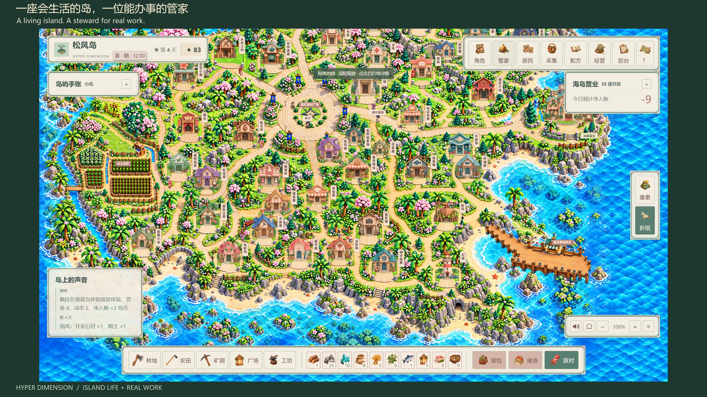

# Hyper Dimension

[中文](README.md) · [English](README.en.md)

**A playful island. A steward for real work.**

Gather, grow, craft, run your island and host parties alongside AI residents. Let your own Hermes Agent steward organize information, plan and work on real documents. Pixel and origami styles share one island and save.

[](https://mkaliezz.github.io/hyper-dimension/#living)

**[Watch the 30-second demo](https://mkaliezz.github.io/hyper-dimension/#living)** · 1440p / 60 fps · Original soundtrack

People and briefs are fictional; AI replies, Hermes file operations and steward A2A letters come from real execution. **Minigames are placeholder demonstrations and will keep improving.**

## Life on the island

| Experience | What you can do |
| --- | --- |
| Run and create | 25 functional building types, 19 crops, 58 materials and 308 recipes. Process goods, use tools, stock visitor shelves, prepare parties and collect wonders. |
| Residents and homes | 15 AI residents with free conversation, work schedules and relationship history; sixteen homes shaped by their owners’ jobs and interests. |
| Your Agent steward | Choose a name and one of 12 appearances. Use Hermes for real work, recruit a temporary partner and assign residents jobs with prerequisites. |
| Seasons and visits | Seasons last 30 visual days; weather affects farming and fishing. Evening lights, waves and moon reflections accompany visits with your steward and invited NPCs, A2A information exchange and cooperative preparation. |
| Showcase and co-create | Display experience, projects and pictures in the owner gallery and receive guest messages. Import OPC products and recipes with both art styles, review, publish, produce and sell; export and roll back versions. |

## Start your island

Install **Node.js 24 and Python 3.11**. Supports Windows x64, macOS 14+ (Apple Silicon / Intel) and Ubuntu. Enter `island/` after cloning, or use the root of a standalone source archive:

```sh
node tools/agent-deploy.mjs plan
node tools/agent-deploy.mjs doctor --python=python
node tools/agent-deploy.mjs setup --python=python --offline
node tools/agent-deploy.mjs verify
node tools/agent-deploy.mjs run --mode=lan
```

Use `--python=python3` on macOS / Ubuntu; omit `--offline` on Ubuntu. Open `http://127.0.0.1:4175/play` after launch.

For split downloads, [verify and assemble the parts](docs/source-parts.md) first.

Keep keys in private `.env.local`; rules mode works without a key. Preserve and back up `data/` and private configuration when updating. Any Agent with terminal access can follow [AGENTS.md](AGENTS.md) and [DEPLOYMENT.md](DEPLOYMENT.md).

[Source downloads](https://github.com/MkaliezZ/hyper-dimension/releases) · [OPC course (Chinese)](public/assets/cocreation/course-v2.md) · [Agents / A2A](docs/a2a-standard-v158.md) · [Education module](https://github.com/MkaliezZ/hyper-dimension/blob/main/README.education.md)

[MIT license](LICENSE) · [Third-party notices](THIRD_PARTY_NOTICES.md)
