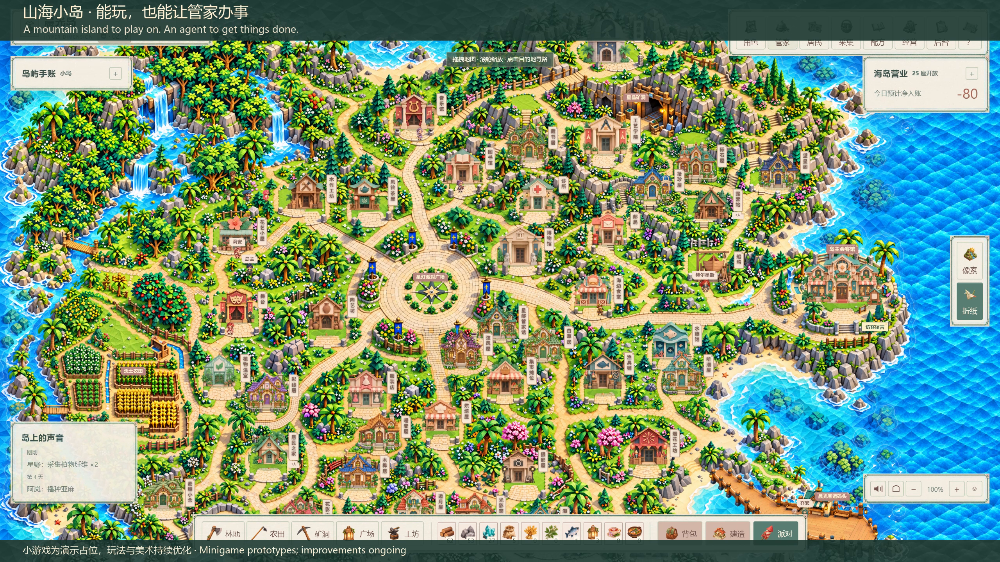
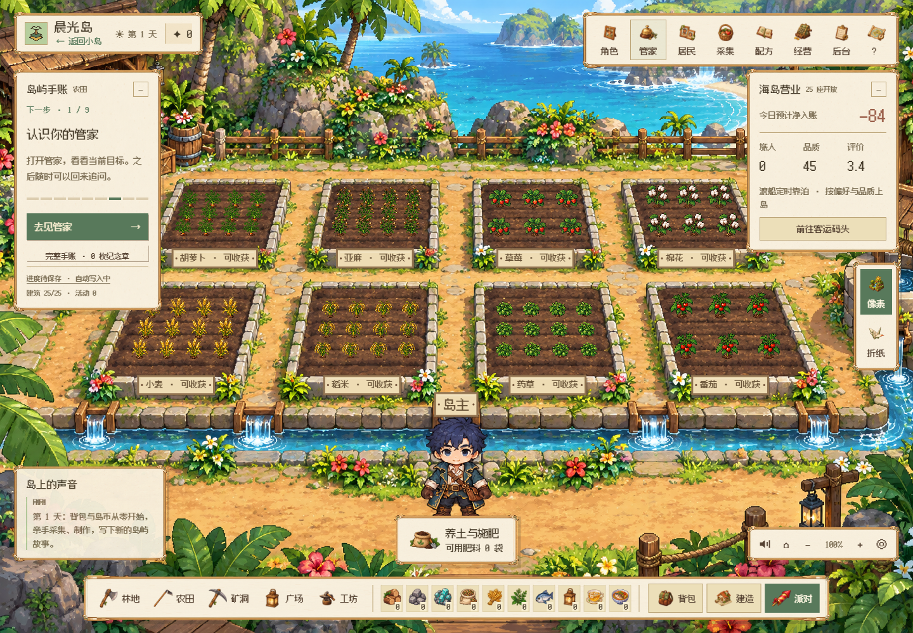
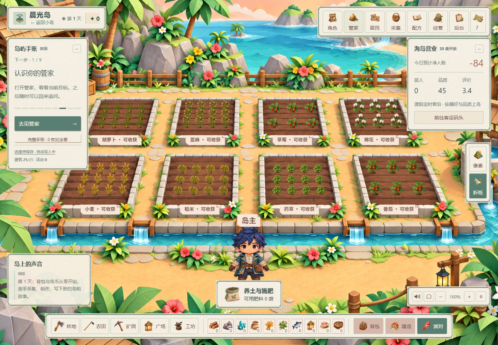
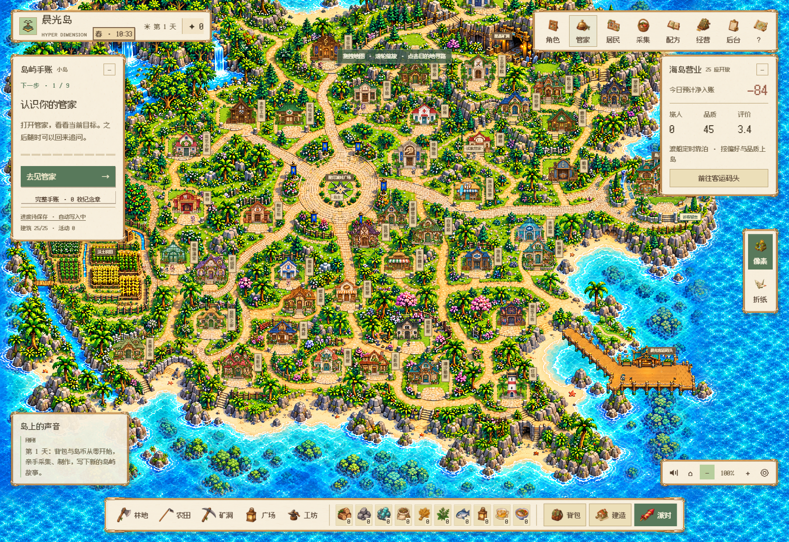
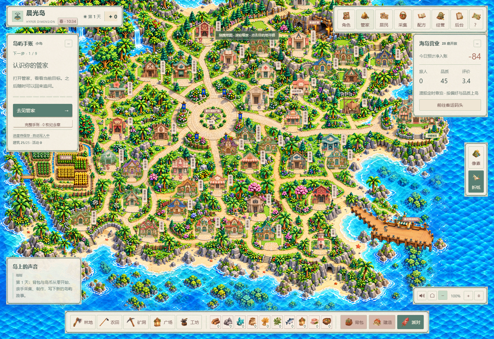

# Hyper Dimension

[中文](README.md) · [English](README.en.md) · [部署指南](DEPLOYMENT.md) · [教培模块](../README.education.md)

**一座会生活的岛，和一位能办事的管家。**

采集、制作、经营、举办派对，与 AI 岛民自由交流；也能委托基于 Hermes 的 Agent 管家读取资料、整理计划和创建真实工作文档。像素与折纸共用同一小岛和存档。

## 先看看小岛

[](https://mkaliezz.github.io/hyper-dimension/#living)

[在线播放 30 秒演示](https://mkaliezz.github.io/hyper-dimension/#living) · [会客馆内部导览](https://mkaliezz.github.io/hyper-dimension/#gallery) · [源码与版本](https://github.com/MkaliezZ/hyper-dimension/releases)

1440p / 60 fps，原创 BGM。新地形片段来自 V169，居民、真实文档、主子 Agent 和小游戏片段保留各自录制版本与验证来源。个人资料和任务文件均为虚构示例。**小游戏目前为占位演示，玩法、美术与动画将继续优化。**

## 当前更新 · V181

16栋新增住所按原折纸建筑重画，统一纸面、折痕和简洁轮廓；屋主身份、门口与地块保持对应，像素素材不变。[美术与校准](docs/origami-homes-v181.md) · [单机交付与联机接续](docs/single-player-readiness-v181.md)。

上一版V180的9项Windows/macOS云端部署、美术与玩法检查已全部通过。[CI记录](https://github.com/MkaliezZ/hyper-dimension/actions/runs/38463636947)。V181的相关14项地形/建筑/旧档检查通过；新提交云端结果另行核对。

### V180 · 连续人物与地形连接

人物改为连续关节表面，工具与服装同步；双画风全部98条底图边界和补绘边缘已检查，农田、船坞、摄影屋补入原生连接素材。网络错误提供明确恢复入口，Mac 部署检查调整运行预算。[改动、美术与证据](docs/terrain-animation-v180.md)。

**1102 项默认门检查**通过，两画风工坊、管家住所、共用存档切换与刷新通过。V180云端9项全部通过。

### V179 · 后台作业与导航

已批准的寻路可在后台作业结算时到达并打开场景；慢帧使用独立的移动预算。NPC 已确认的农田、矿洞与日常作业继续计时并只提交一次，未确认的工具演出在动作末尾停止。田地、物资和奖励仍按服务端回执结算。[修复与证据](docs/navigation-arrival-v179.md)。

本地 **1095 项默认检查**通过，双画风低帧率寻路、六个奖励／取消恢复场景及实际 NPC 播种／浇水检查通过。macOS 云端结果按最新提交单独记录；人物关节和全岛地形接缝正在逐项审查。

### V178 · 全作物生长美术

原有 11 种作物补齐双画风四阶段原生生长图，新增 88 个形象。19 种作物合计 152 个生长阶段，根部与田垄对齐、成熟作物形态和采收工具对应。[生长美术与验证](docs/legacy-crop-art-v178.md)。

### V177 · 联机旧档升级

联机入口补齐旧存档物品目录升级，修复升级后反复出现存档冲突的问题；原库存和活动结算记录保留。[旧档升级修复](docs/lan-catalog-upgrade-v177.md)。

### V176 · 小游戏、布局与时令内容

船坞已移至东南码头旁，烟花工坊迁至内侧台地。修复服装店及共用小游戏保存时周期性无法操作的问题，补齐断线恢复、长按释放和领奖排空保护。[交互与布局修复](docs/minigame-input-v176.md)。

八种新作物与八道时令食品已接入，共 **19 种作物、58 种素材、308 个配方**。新增作物具有双画风四阶段生长图；收获物可用于制作，食品可食用、赠礼、供居民用餐或上架经营。[作物与配方](docs/seasonal-content-v176.md)。

按作物区分镰割、摘果、采叶、松土拔取和托起；旧物品图集顺序和初版成就集合保留。旧档只补缺失的零库存字段，不赠送资源。

本地 **1071 项默认检查**通过，两画风三类新配方的六次实际通关、领取和刷新验证通过。上一版 V175 六项跨平台 CI 全部成功，V176 云端结果单独记录。[验证范围](docs/VALIDATION.md) · [V175 CI](https://github.com/MkaliezZ/hyper-dimension/actions/runs/38388258952)。

### 近期改进

[房屋与地块校准](docs/parcel-alignment-v174.md) · [天气与居民作息](docs/weather-life-v175.md) · [连续移动](docs/frame-motion-v173.md) · [存档入口恢复](docs/save-entry-v172.md) · [山海地形与住所](docs/geography-v169.md)。

[已发布 V170 部署包](https://github.com/MkaliezZ/hyper-dimension/releases/tag/v170) 保留独立离线重建证据。源码更新、云端检查和不可变发布包分别验证。

## 在岛上做什么

| 体验 | 内容 |
| --- | --- |
| 从零经营 | 25 种生产建筑、58 种基础素材、308 个配方；采集、制作、游客消费与岛务开支。一个经营日为 900 秒有效游戏时间。 |
| 与居民生活 | 15 位 AI NPC 根据职业、性格和关系行动，支持自由对话、居民交谈与合作。模型为 DeepSeek V4.1 Flash。 |
| 委托管家 | 自定义姓名、12 种形象；Hermes 读取委托资料、创建文档、追踪任务，并招募临时 Agent 伙伴协作。 |
| 展示与接待 | 岛主会客馆展示介绍、教育／就业／人生经历、项目与图片；支持上传、草稿、发布、访客留言和回复。 |
| 带管家来访 | 联机会客厅、随行 NPC、原机管家桥接及标准 A2A 通信，共用有来源的协作记录。跨设备使用需要配对与目标设备在线。 |
| 双画风 | 像素／折纸的地图、建筑、人物、房间、物品和 UI；高清分块、海面水纹与近岸浪。 |

每季 30 个视觉日；天气影响、季节播种和居民归家作息已接入。扩容地图的完整四季原生美术、夜间灯光及月影仍在制作，住所内部仍使用现有展示入口。

## 实际运行画面

| V178 像素农田（成熟作物验证场景） | V178 折纸农田（成熟作物验证场景） |
| --- | --- |
|  |  |

| 像素海岛 | 折纸海岛 |
| --- | --- |
|  |  |

## 交给开发 Agent 部署

交付形态为**源码、素材、固定依赖与机器可读部署协议**。支持 Windows x64、macOS 14+ 的 Apple Silicon / Intel；Ubuntu 也可运行。克隆仓库后进入 `island/`，Release 源码包直接以游戏目录为根。

让具备终端和文件权限的 Agent 阅读 [AGENTS.md](AGENTS.md)、[deploy.json](deploy.json) 和 [DEPLOYMENT.md](DEPLOYMENT.md)，执行：

```sh
node tools/agent-deploy.mjs plan
node tools/agent-deploy.mjs doctor --python=python
node tools/agent-deploy.mjs setup --python=python --offline
node tools/agent-deploy.mjs verify
node tools/agent-deploy.mjs run --mode=lan
```

macOS 通常使用 `--python=python3`；推荐 Node.js 24 与 Python 3.11。`--offline` 使用包内固定依赖，Windows/macOS CPython 3.11 可用。

- `lan`：会客厅与小岛，默认 `http://127.0.0.1:4175/play`。
- `pixel` / `origami`：独立启动方式；画风仍是同一存档的外观选择。
- API 密钥只写入目标机私有 `.env.local` 或环境变量；无密钥可运行规则模式。
- 更新时保留 `data/`、私有配置和原机工作目录，按部署指南备份后迁移。

## 开发与接口

- [游戏源码与部署](AGENTS.md) · [标准 A2A 1.0](docs/a2a-standard-v158.md) · [原机工作区桥接](docs/device-bridge-v138.md)
- [物资与配方](docs/production-contracts-v114.md) · [经营趋势](docs/economy-v143.md) · [居民生活](docs/resident-life-v112.md)
- [验证范围](docs/VALIDATION.md) · [GitHub Actions](https://github.com/MkaliezZ/hyper-dimension/actions) · [版本发布](https://github.com/MkaliezZ/hyper-dimension/releases)

## 许可

代码遵循 [MIT](LICENSE)，第三方组件见 [声明](island/THIRD_PARTY_NOTICES.md)。新增海岛美术为本项目生成素材；公开媒体只使用隔离演示岛与虚构资料。
