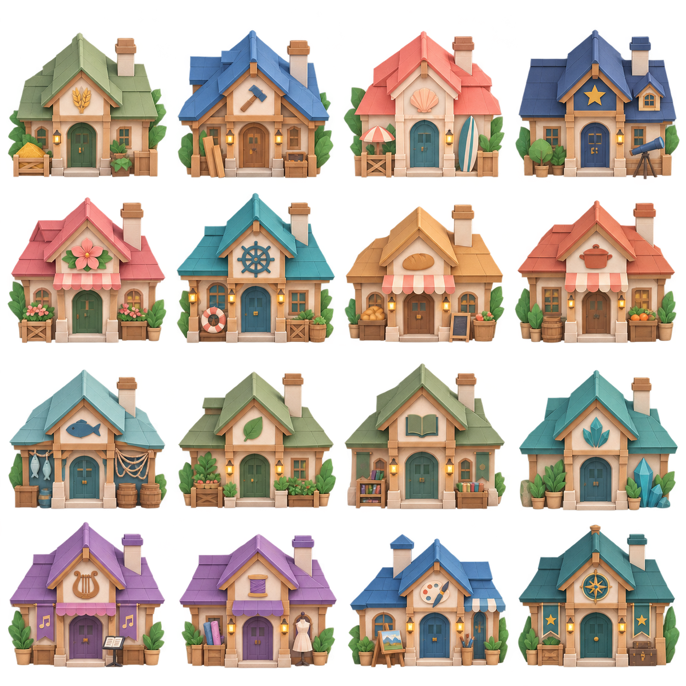

# V181 · 折纸居民住所 / Paper residences

本轮实际总览与原始图集核对发现：V169新增16栋住所的密集瓦片、圆拱、立体花草及装饰密度更接近童话木屋，与原25栋折纸功能建筑的大纸面和简洁轮廓不一致。

已使用内置image_gen重画16栋住所，采用原功能建筑为风格依据：宽纸片屋顶、清楚折痕、哑光纸面、克制的植物与职业徽记。保留16个屋主ID、配色与功能识别，像素版素材不变。

## 接入与核对

- 新素材为原生1254×1254 RGBA，16栋完整独立建筑；没有对生成像素做裁切、涂改或放大保存。
- 按整图透明连通区生成16个完整取样框，避免图集跨格屋顶截断；重新标记每栋门口的水平轴，仍对齐已有地块门口。地图、寻路、屋主ID和存档结构没有变化。
- 现有14项地形/旧档/建筑检查通过，覆盖两画风41栋建筑身份与等比显示、所有住所和功能建筑入口可达、全部奇观陈列后的通路。
- 当前本机折纸页面完成总览、放大和管家住所入口核对；用户存档画面保存在私人验收目录，不进入公库。独立实体Mac与真人整体验收仍按原清单进行。
- [生成依据、提示词和像素哈希](origami-homes-v181.json)；[单机剩余工作与联机接续](single-player-readiness-v181.md)。

## 审查记录

1. 原图与游戏总览：功能正常，新增住所的装饰密度、屋顶材质与旧折纸建筑不一致。
2. 新图与游戏总览：16栋住所均显示，轮廓、配色和纸面与邻近功能建筑更一致。细小文字在总览尺度仍需缩放阅读，此次没有据此声称完整可访问性达标。
3. 地块与点击：完整取样框和门口轴共同用于显示与点击，身份、路径和比例通过规则核对，实际入口另做本机UI验证。

The sixteen added homes have been redrawn against the original paper-building reference, preserving owner IDs and palettes while replacing dense tiled roofs and ornate fairy-tale decoration with broad matte paper planes and clear folds. Original generated RGBA pixels are retained. Whole-image component bounds and separately calibrated door axes keep complete roofs and existing parcels aligned. Fourteen existing geometry/migration/navigation checks pass. This bounded visual fix does not claim whole-product or physical-device acceptance.
