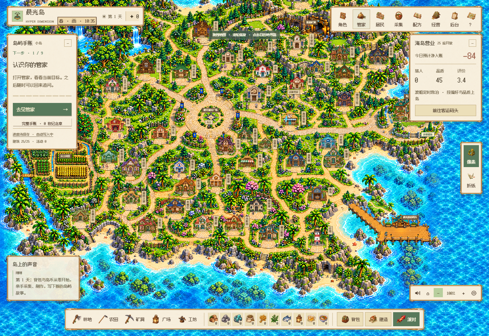
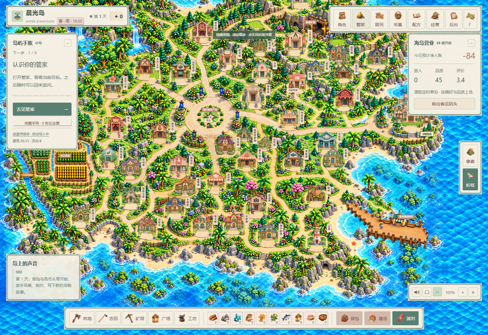

# V180 · 连续人物、全岛接缝与断连提示

## 改动

- 人物原图使用共享顶点的连续表面；肩、肘、腰、腿不再独立切块平移。工具和手套沿同一关节位置绘制，完整服装与头饰也覆盖检查。
- 闲置角色仍直接绘制原图。工作和行走姿态使用插值缓存；姿态缓存限64 MiB、GPU纹理限96 MiB，缺少WebGL时保留Canvas连续表面。初始化和后台素材加载的长帧单独记录。
- 两套画风的30块底图，全部98条邻接边界及原14处补绘边缘已经逐项查看。农田、船坞、摄影屋连接区域各新增两套原生重绘；新增6处边缘也检查，补绘叠放次序固定，不随镜头改变。
- 网络错误显示本机服务连接和“核对全部并继续”的恢复说明，已提交游客请求仍按原回执恢复。
- V179云端8个任务成功，Intel部署任务在45分钟时取消，其中源码拉取占约30分钟。部署检查总预算改为60分钟，新提交的结果另行核对。

## 验证与美术

默认门1102项通过：1088项领域规则、14项运行目录保护；运行保护因沙箱进程列表读取限制单独重跑，原断言保留。两画风实际地图中进入工坊、访问对应管家住所、切换同一存档并刷新通过。

448个原生人物帧完成解码，七类动作3136个原生图样及480个服装/帽子/手套/工具组合图样用于审查。行走、锄地、浇水的常驻动作采样均未出现超过25毫秒的帧间隔；初始化仍有长帧，折纸闲置采样有两次后台加载长帧，未据此宣称全流程无卡顿。

| 范围 | 记录 |
| --- | --- |
| 98条底图边界和20处补绘周边 | [逐项清单](terrain-seam-review-v180.json) |
| 6张原生重绘，尺寸和SHA-256 | [原生来源](native-join-art-provenance-v180.json) |
| 人物、服装、地图与帧样本 | [原始范围与时序](character-animation-evidence-v180.json) |

这些游戏界面来自隔离、无模型调用的虚构夹具。地形局部和接缝图是原生渲染审查图；未作为真实玩家资料或宣传视频使用。

## 素材提示词

使用内置image_gen编辑原生渲染的公开地形局部。最终素材位于 `public/assets/map-joins-v180/`：每种画风均为 `farm-join`、`boatyard-join`、`photo-join` 三张PNG。原始区域PNG保留，新PNG未由Python绘制、改色或放大。

三类提示词共同要求：固定原镜头、裁切、房屋空地中心、入口、道路和河岸，外沿12%保留；禁止房屋、人物、UI、文字、网格、滤镜、模糊、新增地块或移动道路。折纸保持纸面折痕与几何植物，像素保持细小明确像素簇与阶梯边缘。

- 农田：以旧裁切为编辑目标、较宽修复图为结构参考；棉花、绿叶蔬菜、玉米、小麦四个独立田块，每块统一作物和成行株距、单层完整木框、块间沙土通道，修好中段换作物与交叉栅栏，保留水槽、水轮和院落范围。
- 船坞：只修裁切高度36.7%附近的水平连接；草地基座、石柱与石铺入口固定，连接处道路宽度、石纹尺度、海边台阶和岸边岩石遮挡保持连续。
- 摄影屋：只修裁切高度28.3%附近的水平连接；全部草地、石柱和道路位置固定，后方木栏与树丛不出现切断，路沿宽度、铺石尺寸与透视保持连续。

## 当前边界

新提交的云端检查、完整季节底图、夜灯/月影、组合经济与最新视频继续单独记录。此轮未运行新的独立离线重建，也不替代物理Mac或真人验收。
